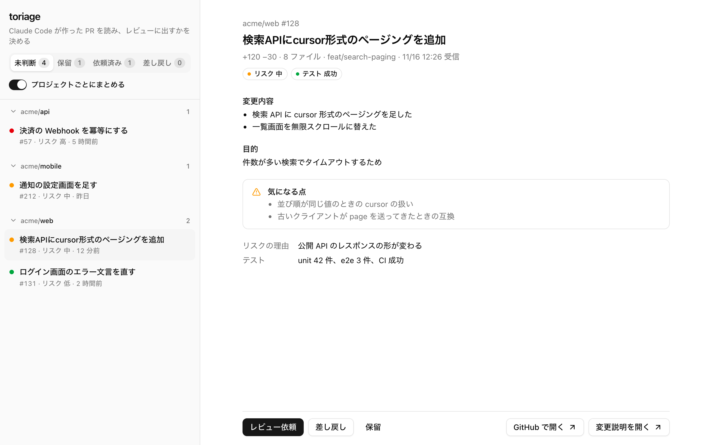
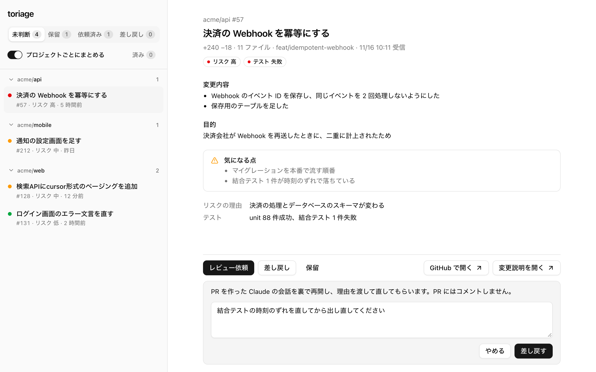
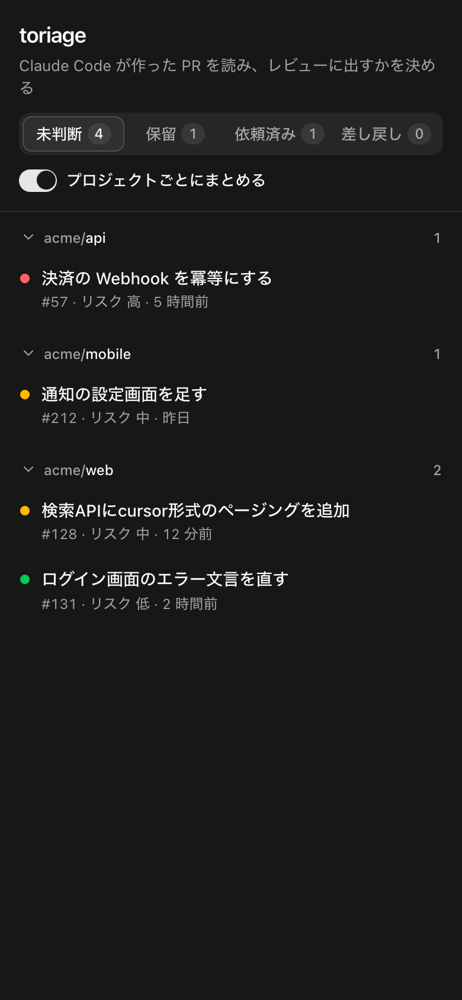
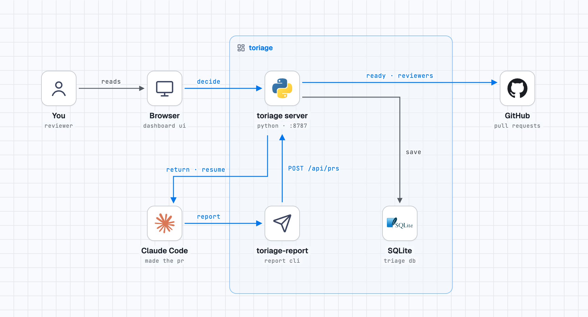

# toriage

toriage(とりあげ)は、Claude Code や Codex が作った PR を、レビューに出すかどうか手元のブラウザで決めるプラグインです。Claude Code と Codex のどちらにも入れられます。エージェントが書いた判断材料をカードで読み、「レビュー依頼」「差し戻し」「保留」のボタンを押すと、その場で反映されます。レビュー依頼は GitHub に、差し戻しは PR を作ったエージェントに届きます。名前は triage(トリアージ、選り分け)と「取り上げる」を掛けています。



## なぜ作ったか

Claude Code や Codex に PR を作らせると、PR の数が人の読む速さを超えます。1 件ずつ GitHub を開いて差分を読み、出してよいかを決めるのは重い作業です。

toriage では、PR を作ったエージェント自身が「何を変えたか、なぜ変えたか、どれくらい危ないか、どこを人が見るべきか、テストは通ったか」を書いて送ります。人はそれを読んで、レビューに回すか、直させるか、後回しにするかだけを決めます。

## できること

- **判断材料をカードで読む**: 変更内容、目的、リスク(低・中・高)とその理由、気になる点、テストの結果を 1 枚にまとめます。変更の行数とファイル数は `gh` から取るので、エージェントの書き間違いは入りません
- **ボタンで反映する**: レビュー依頼はサーバーが手元の `gh` で GitHub に反映します。反映に失敗したときは判断の状態を変えず、理由を画面に出します
- **PR を作ったエージェントに差し戻す**: 差し戻すと、PR を作った Claude Code か Codex の会話を裏で再開し、理由を渡して直してもらいます。直して送り直すと、カードは未判断に戻ります
- **リポジトリごとにまとめる**: 複数のリポジトリで PR を作っていても、リポジトリ名の見出しの下に並びます。スイッチでまとめない表示にも戻せます
- **手元だけで動く**: サーバーは `127.0.0.1` でだけ待ち受け、データは手元の SQLite に入ります。GitHub の権限は `gh` のログインをそのまま使い、外のサービスには預けません
- **起動を気にしない**: Claude Code か Codex を開くとダッシュボードが裏で起動し、閉じても動き続けます。止まっていても、報告を送るときに起動し直します

判断はカードを開いて、ボタンを押すだけです。差し戻しのときは直してほしいことを書きます。PR にはコメントせず、PR を作ったエージェントに渡します。



画面は OS の設定に合わせてダークモードになり、スマートフォンの幅でも崩れません。



## しくみ

<picture>
  <source media="(prefers-color-scheme: dark)" srcset="docs/images/architecture-dark.png">
  
</picture>

1. Claude Code か Codex を開くと、フックがダッシュボードのサーバーを裏で起動します(Codex はフックを信頼してから)
2. PR を作ったあと、Claude Code か Codex がスキル `toriage:report` に従って判断材料の JSON を書き、`toriage-report` で送ります。届くと、ダッシュボードがブラウザで開きます
3. 送る前に、サーバーと同じ検証を通します。ダッシュボードに届かなかったときは inbox に置き、次に起動したときに取り込みます
4. 人がブラウザで判断すると、サーバーが反映します。レビュー依頼は `gh` で GitHub に、差し戻しは PR を作った Claude Code か Codex の会話を裏で再開して理由を渡します

図は Claude Code の場合です。Codex でも同じ流れで動きます。[stack-diagram](https://github.com/caru-ini/stack-diagram) で描いた [`docs/images/architecture.html`](docs/images/architecture.html) を撮ったものです。

## 必要なもの

- Claude Code か Codex(Codex は CLI 0.167 で確かめました)
- [GitHub CLI](https://cli.github.com/)(`gh auth login` 済み)
- `jq` と `curl`
- Python 3.13 以上。なければ [uv](https://docs.astral.sh/uv/) が Python 3.13 を用意して動かします
- macOS か Linux

## 入れ方

Claude Code で次の 2 つを実行します。

```
/plugin marketplace add h11roki/toriage
/plugin install toriage@h11roki
```

入れたあと Claude Code を開き直すと、ダッシュボードが起動します。`/toriage:open` で画面を開けます。

Codex では、ターミナルで次の 2 つを実行します。Codex は Claude Code のプラグインの形をそのまま読みます。

```sh
codex plugin marketplace add h11roki/toriage
codex plugin add toriage@h11roki
```

Codex は、フックを確かめて信頼するまで、開いたときにダッシュボードを起動しません。信頼しなくても、報告を送るときに起動します。

## 使い方

### PR の判断材料を送る

PR を作ったあと、Claude Code には `/toriage:report` を、Codex にはスキル `toriage:report` を使わせます。毎回頼まなくて済むよう、`CLAUDE.md` や `AGENTS.md`、自分の PR 作成のスキルに次のように書いておくのがおすすめです。

```markdown
PR を作ったら、スキル toriage:report でダッシュボードに判断材料を送る。PR を直したときも送り直す
```

エージェントが書く項目は次のとおりです。題、ブランチ、URL、変更の数は `gh` から自動で足されます。

| 項目 | 内容 |
|---|---|
| `summary` | 何を変えたか(1〜3 行) |
| `why` | 変更の目的、元の依頼 |
| `risk` | `low` / `medium` / `high`。迷ったら 1 段上 |
| `risk_reason` | そのリスクにした理由 |
| `concerns` | 人が必ず見るべき箇所、自信がない点 |
| `tests` | `passed` / `failed` / `not_run` と、CI を含めた結果 |
| `suggested_reviewers` | レビュアーの候補(GitHub のユーザー名か `org/team`) |
| `artifact_url` | 変更の説明を書いたページ(省略可) |

同じ PR を送り直すと、カードは新しい内容に置き換わります。差し戻した PR を直して送り直すと、未判断に戻ります。

報告が届くたびに、`toriage-report` がダッシュボードをブラウザで開きます(macOS は `open`、Linux は `xdg-open`。SSH でつないだときなど、画面の無い Linux では開きません)。開いているタブがあっても、新しいタブで開きます。開かないようにするには、環境変数 `TORIAGE_OPEN` を `0` にします。Claude Code の `settings.json` の `env` に書くと、差し戻しで裏で再開した Claude にも効きます。Codex では `config.toml` の `shell_environment_policy.set` に書きます。inbox に保存したときは開きません。

Codex はプラグインの `bin` を PATH に入れないので、スキルに書いた場所から送信スクリプトを動かします。手元のダッシュボードと GitHub につなぐため、送るたびにサンドボックスの外で動かす許可を求めます。

### 判断する

http://127.0.0.1:8787 を開き、未判断のカードを開いてボタンを押します。

| ボタン | 起きること | 移る先 |
|---|---|---|
| レビュー依頼 | Draft を外して Ready にし、`suggested_reviewers` をレビュアーに付ける | 依頼済み |
| 差し戻し | PR を作った Claude Code か Codex の会話を裏で再開し、理由を渡して直してもらう。PR にはコメントしない | 差し戻し |
| 保留 | 何もしない | 保留 |

ボタンが出るのは未判断と保留のカードです。保留のカードからは、あとでレビュー依頼か差し戻しを選べます。差し戻しのカードには、裏のエージェントが途中で止まったときにやり直せるよう、差し戻しだけが出ます。

差し戻しには、報告を送った会話の ID が要ります。`toriage-report` が、Claude Code の `CLAUDE_CODE_SESSION_ID` か Codex の `CODEX_THREAD_ID` から自動で付けます。どちらでもない場所から送った報告と、両方がある環境(Claude Code の中で Codex を動かしたときなど)から送った報告には、差し戻しのボタンが出ません。

裏の Claude は `claude -p --resume <ID> --permission-mode auto` で動き、安全と判定された操作(編集、テスト、push など)だけを行います。裏の Codex は `codex exec resume <ID>` で動きます。作業ツリーへの書き込みだけを許すサンドボックスに入れ、push のようにそれを超える操作は Codex の自動の審査(`--approve-for-me` と同じ設定)に任せます。`codex` は、環境変数 `TORIAGE_CODEX`、PATH、ChatGPT アプリと Codex アプリの中の順に探します。

様子は `returns/<ID>.log` か、`claude --resume <ID>`、`codex resume <ID>` で見られます。T3 Code や Codex アプリなどで同じ会話を開いたままにしていると、その画面には出ず、会話が枝分かれします。

PR は Draft で作るのがおすすめです。判断するまでレビュアーに通知が飛ばず、「レビュー依頼」を押したときにはじめて Ready になります。

## データと起動

データは `~/.local/share/toriage/` に置きます。`TORIAGE_HOME` を絶対パスで設定するとその場所に、`XDG_DATA_HOME` を絶対パスで設定しているとその下に置きます。

| ファイル | 中身 |
|---|---|
| `prs.db` | 報告と判断。消せばリセットできる |
| `inbox/` | 届かなかった報告。次に起動したときに取り込む |
| `returns/` | 差し戻して裏で再開した Claude Code か Codex の出力。会話ごとに 1 ファイル |
| `server.log` | サーバーの記録。起動できなかった理由もここに出る |
| `server.pid` | 動いているサーバーのプロセス番号。起動したときに書き、止まるときに消す |

プラグインを更新したあとは、動いているサーバーが古いままです。新しく始めた Claude Code の会話で、Claude に `toriage-start --restart` を実行させて起動し直します(`bin/` のコマンドは、プラグインが有効なあいだ Claude の Bash から使えます。更新する前から続いている会話では、古い版の `toriage-start` が動きます)。止められなかったときは、理由を出して失敗します。

Codex では `codex plugin marketplace upgrade h11roki` と `codex plugin add toriage@h11roki` で更新します。Codex の Bash からは `bin/` のコマンドを名前で呼べないので、起動し直すときは `~/.codex/plugins/cache/h11roki/toriage/<版>/bin/toriage-start --restart` を実行します。

止めるときは `curl -X POST http://127.0.0.1:8787/api/shutdown` を実行します。プラグインを消してもデータは残るので、要らなければ手で消してください。

## 安全のために

- サーバーは `127.0.0.1:8787` でだけ待ち受けます
- ほかのサイトからの要求を断るため、Host、Origin、Content-Type を確かめます
- GitHub への操作は、ボタンを押したときにだけ、その PR のリポジトリを `-R` で指定して `gh` で行います
- サーバーは `GH_TOKEN` と `GITHUB_TOKEN` を外して起動するので、どのセッションから起動しても `gh auth login` のアカウントで操作します
- 差し戻すと、人が見ていないところで Claude Code か Codex が動きます。Claude は auto モードの判定で、Codex は自動の審査で危ないとされた操作が断られ、その場で止まります

## 開発

```sh
uv sync
uv run ruff check . && uv run ruff format --check . && uv run mypy && uv run pytest
```

手元のコードを試すときは `claude --plugin-dir .` で Claude Code を開きます。サーバーだけなら `python3 server.py` で起動できます。

実行時は Python の標準ライブラリだけを使い、画面は `static/index.html` 1 ファイルの HTML と素の JavaScript です。見た目は [shadcn/ui](https://ui.shadcn.com/) の色と部品の形を CSS で写しています。設計判断は [docs/adr/](docs/adr/README.md) にあります。

## ライセンス

[MIT](LICENSE)
