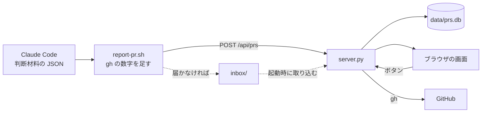

# 0001. 手元の PC だけで動く 1 枚の画面にし、Python の標準ライブラリと SQLite で作る

- ステータス: 承認
- 日付: 2026-11-15

## 文脈

- Claude Code が PR を作ったあと、レビューに出すかを人が判断している。今は Slack の通知で知らせているが、文面が読みづらく、何を変えたか、リスク、テスト結果を探す手間がかかる
- 判断したあとの GitHub の操作(Draft の解除、レビュアーの指定、差し戻しのコメント)も別に要る
- 使うのは自分 1 人で、費用はかけたくない
- 構成は設計書「PRトリアージダッシュボード 企画・設計書」で決めた

## 検討した選択肢

1. 手元で動く小さなサーバーにする。Python の標準ライブラリ、SQLite のファイル 1 つ、HTML と素の JavaScript の画面 1 枚
2. Web フレームワーク(FastAPI など)とビルドの要るフロントで作る
3. GitHub の中で済ませる(ラベルと Projects、Actions で通知する)
4. Slack の通知の文面を直すだけにする

## 決定

1 にする。

- 変更行数などの数字は report-pr.sh が `gh` から取り、要約、目的、リスク、気になる点、テスト結果だけを Claude が書く
- server.py が受け取り、`repo` と `number` の組で上書きして SQLite に保存し、一覧の API と画面を返す。上書きしても判断の状態は変えない。ただし差し戻し中の PR は未判断に戻し、直したものをもう一度判断できるようにする(0002 の再送)
- 待ち受けは `127.0.0.1:8787` だけにする
- 送るときにダッシュボードが止まっていれば、report-pr.sh が `inbox/` に保存し、server.py が次に起動したときに取り込む。ファイルを書いた時刻を受信日時とし、保存してある報告より新しいときだけ上書きする
- GitHub の操作は、認証済みの `gh` CLI をサーバーから実行する(フェーズ 3)

## 理由

- 標準ライブラリだけなら `pip install` もビルドも要らず、`python3 server.py` の 1 つで動く。画面は 1 枚、API は 6 つで、フレームワークの助けが要る量ではない
- SQLite のファイル 1 つなら DB のサーバーが要らず、消せばリセットできる
- 数字を `gh` から取れば、変更行数のような事実に Claude の書き間違いが混ざらない
- `gh` はすでに認証してあり、トークンを新しく作って置かずに済む
- 3 では、Claude の書いた判断材料を 1 枚にまとめて並べる場所がなく、通知はまた別の画面に届く
- 4 では、判断のあとの GitHub の操作が別に残る

## 受け入れたトレードオフ

- 手元の PC が動いていないと受け取れない(inbox で補う)。スマホからは見られない
- server.py 1 つに、API、保存、画面の配信、`gh` の実行が入る
- サーバーは自分の GitHub の権限で `gh` を実行するので、ほかから要求を受けないようにする必要がある(0003)

## 再検討する条件

- スマホから判断したくなったとき
- server.py が大きくなり、1 ファイルでは読みにくくなったとき。フェーズ 3 で `gh` の実行を足すときに見直す
